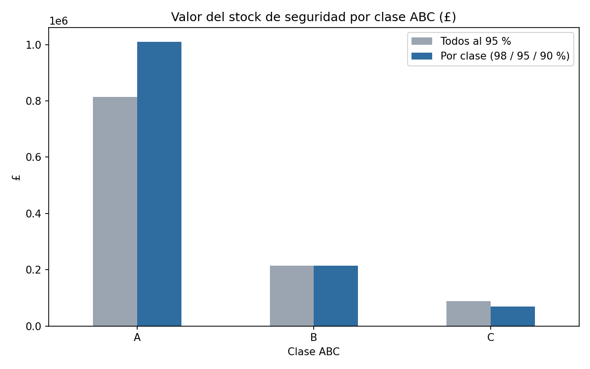

# Safety stock and reorder point by ABC class: Python (pandas)

How much safety stock does each of 3,777 products need, and where should the money go? This project calculates the **safety stock** and **reorder point** of every product of a UK online gift wholesaler. It uses one year of real monthly sales, and service levels are set by **ABC class**.

It continues my [ABC-XYZ inventory classification](https://github.com/nordin94/inventory-abc-xyz-analysis). That project showed *which* products matter. This one calculates *how much stock* each of them needs. It is done in **Python (pandas, NumPy, Matplotlib)** in a Jupyter notebook.



## The answer in four lines

1. **Total safety stock: 661,865 units, worth £1.29M.** 78% of that money sits in class A products, which bring 80% of revenue.
2. **A service level per class moves money to where stock-outs cost the most.** Compared with a flat 95% for every product, it adds **£196k** to class A (98% service) and frees **£19.4k (−22%)** in class C (90% service).
3. **The policy does not save money: it reallocates risk.** In total it costs £177k more than the flat 95%. It lowers the risk on the products that make the revenue and cuts back on products that barely sell.
4. **Irregular demand drives the bill.** 2,346 products with a coefficient of variation above 1 hold £711k, 55% of the safety stock value. For them a forecast-based method would beat a simple standard deviation (see *Limitations*).

| Class | Products | Service level | Z | Flat 95% (£) | By class (£) | Difference (£) |
|---|---|---|---|---|---|---|
| **A** | 833 | 98% | 2.05 | 813,537 | 1,009,985 | **+196,448** |
| **B** | 963 | 95% | 1.65 | 214,482 | 214,482 | 0 |
| **C** | 1,981 | 90% | 1.28 | 89,286 | 69,888 | **−19,398** |
| **Total** | 3,777 | | | 1,117,305 | 1,294,355 | +177,050 |

## Method

```
Safety stock  = Z × σ(monthly demand) × √(lead time)
Reorder point = average monthly demand × lead time + safety stock
```

- **σ (sigma):** population standard deviation (`ddof=0`, same as Excel `DESVEST.P`) of units sold per month over 12 full months (Dec 2010 to Nov 2011).
- **Z:** set by ABC class (A 98%, B 95%, C 90%). ABC is recalculated in Python with the same rule as the previous project (cumulative revenue ≤ 80% = A, ≤ 95% = B, rest = C), and gives the same counts: 834 / 963 / 2,008.
- **Lead time:** 1 month. **This is an assumption**: the dataset has no supplier data. It is a single variable in the notebook (`lead_time`), so the whole table recalculates if it changes.
- **Value:** safety stock units × average selling price (revenue ÷ units). It is valued at selling price because the dataset has no cost price, so the £ figures are an upper bound of the money tied up.
- Results are rounded **up** (`np.ceil`): a warehouse cannot hold 4.3 units.

## Data cleaning in Python

| Check | What I found | What I did |
|---|---|---|
| Types (`info()`) | `month` loaded as text | Converted with `pd.to_datetime` |
| Nulls | None in 31,108 rows | — |
| **Months without sales have no row** | Only 31,108 of 45,636 product-months exist: 14,528 zero months are missing. The median product has 9 of 12 months | Pivoted to one column per month with `fill_value=0`. Without the zeros, irregular products look stable and get **too little** safety stock |
| Impossible values | 26 products with average demand ≤ 0 (more returns than sales) | Removed: no real demand, no safety stock |
| Join check | `merge` with ABC classes | 0 products without a class after the LEFT JOIN |

## Files

| File | What it is |
|---|---|
| `notebooks/safety_stock_analysis.ipynb` | The full analysis, step by step, with outputs |
| `data/monthly_sales.csv` | Units per product per month (from the ABC-XYZ project's cleaning) |
| `data/products_clean.csv` | One row per product with revenue and units |
| `data/safety_stock_results.csv` | **Result:** safety stock, reorder point and £ value for each of the 3,777 products, sorted by value |
| `images/safety_stock_by_class.png` | Chart: flat 95% vs service level by class |

To run the notebook, open it in Jupyter or Google Colab from the `notebooks` folder (it reads `../data/`).

## Limitations and next step

- **Seasonal and new products.** The top item by safety stock value, RABBIT NIGHT LIGHT, first sold in May 2011 and peaked at 14,883 units in November. The months before its launch count as zero, and its Christmas peak makes σ (4,194) almost twice its average (2,199). A single yearly σ treats a predictable seasonal peak as random noise, so its safety stock (8,599 units) is too high for most of the year and too low in November.
- **Lead time is fixed** at one month for every product. With real supplier data, lead time variability would be added to the formula.
- **Next step:** a monthly demand forecast, so that safety stock covers the forecast error instead of the raw variation.

## Data source

[Online Retail](https://archive.ics.uci.edu/dataset/352/online-retail), UCI Machine Learning Repository (Daqing Chen, 2015), licensed CC BY 4.0. Cleaning of the raw file is documented in the [ABC-XYZ project](https://github.com/nordin94/inventory-abc-xyz-analysis).

## Tools

Python 3 · pandas · NumPy · Matplotlib · Google Colab
